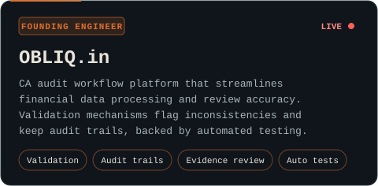
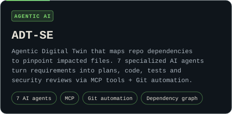
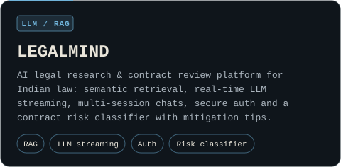
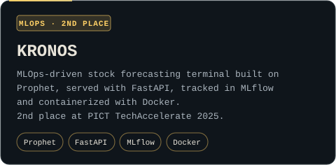

 

&nbsp;

  

<!-- LINKEDIN / PORTFOLIO: when you have the URLs, copy btn_github.svg to btn_linkedin.svg (edit label/value inside), then add:
&nbsp;
-->

 

 

<table>
<tr>
<td width="50%"></td>
<td width="50%"></td>
</tr>
<tr>
<td width="50%"></td>
<td width="50%"></td>
</tr>
</table>

 

 

 

 

 

&nbsp;

  

